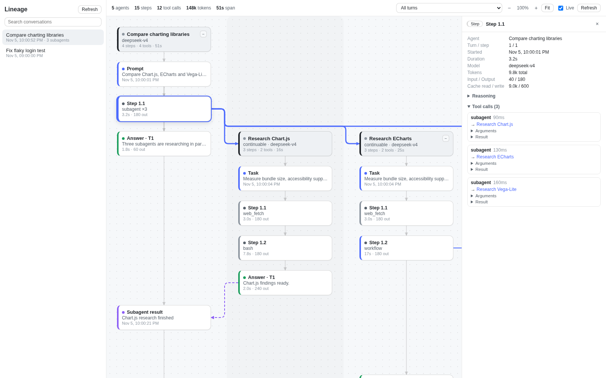
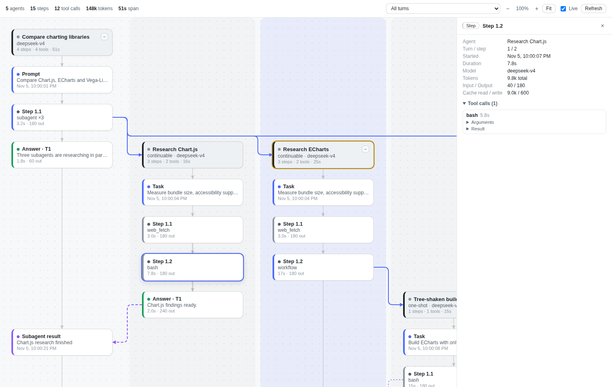
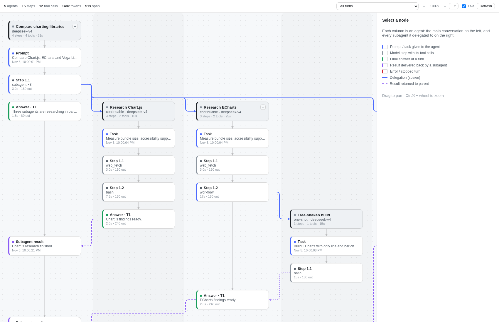
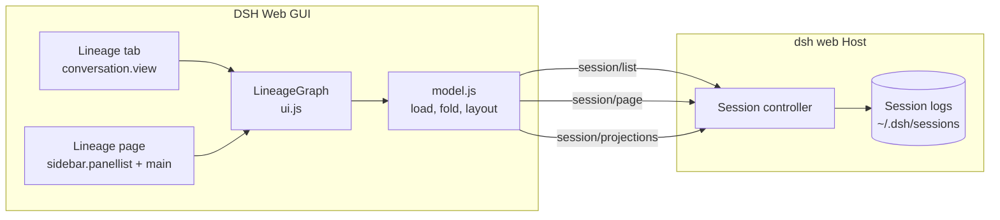

# Lineage4Agent for DeepSeek Harness (`dsh-lineage`)

**See how an agent reached its answer.** `dsh-lineage` is a plugin for the [DeepSeek Harness](https://www.npmjs.com/package/@deepseek-ai/dsh) (DSH) Web GUI. It draws any conversation as a swimlane graph: the prompt, every model step and tool call, each subagent the agent delegated to (at any depth), and the results that came back.



> The screenshots come from the [standalone demo](#try-the-demo-without-dsh), which runs the real plugin bundle on synthetic data.

---

## Contents

- [Features](#features)
- [Where to find it in DSH](#where-to-find-it-in-dsh)
- [Reading the graph](#reading-the-graph)
- [Install](#install)
- [Try the demo without DSH](#try-the-demo-without-dsh)
- [How it works](#how-it-works)
- [Project layout](#project-layout)
- [Development](#development)
- [Limitations](#limitations)
- [Documentation](#documentation)
- [License](#license)

## Features

- **Lineage tab in every chat**, next to Chat and Trajectory.
- **Lineage button in the left sidebar**, right after *Automation tasks*. It opens a page where you pick any conversation.
- **Subagent branches at any depth.** Each agent gets its own column. A blue edge connects the step that called `subagent`, `subagent_fork` or `workflow` to the child it created, and a purple dashed edge shows the result coming back.
- **Node details.** Click a node to see the full prompt or answer, reasoning, each tool call with arguments, result, duration and errors, token usage (input, output, cache), and links to parent and child agents.
- **Turn focus.** Show only one question and its answer, plus the subagents whose results fed into it.
- **Live mode.** Refreshes every 3 s while any agent in the tree is still running.
- **Navigation.** Zoom (buttons or Ctrl/⌘ + wheel), Fit, drag to pan, and collapse or expand a subagent subtree.
- **Open conversation** jumps from any agent node to its chat, including subagent chats.
- **Read-only.** It uses the Host APIs the GUI already calls (`session/list`, `session/page`, `session/projections`) and never writes to a session.
- **Zero dependencies.** One hand-built bundle (67.8 kB, 19.1 kB gzipped) that uses the shell's own React.

## Where to find it in DSH

| Entry point | What it shows |
| --- | --- |
| **Lineage** tab in a conversation | The open chat's lineage. If you opened a subagent's chat, the graph starts at its root conversation and highlights that subagent's column. |
| **Lineage** button in the sidebar panel list | A searchable list of conversations (newest first, with subagent counts). Selecting one shows its graph. |



## Reading the graph



| Element | Meaning |
| --- | --- |
| Column (lane) | One agent. The root conversation is on the left; children sit to the right of their parent, in delegation order. |
| Dark card | Agent header: name, mode (`continuable`, `one-shot`, `external`), model, steps, tools and active time. `−` / `+N` collapses its subagents. |
| Blue card | **Prompt** (root) or **Task** (the instruction a subagent received). |
| Grey card | **Step** `turn.step` with the tools it called (`bash ×3 · read`). Blue left border = it delegated work. |
| Green card | **Answer** of a turn (a step with text and no tool calls). |
| Purple card | **Subagent result** or message delivered back to the parent. |
| Red card | Error or stopped turn. A step whose tool failed shows `· tool error`. |
| Grey line | Order within one agent. |
| Blue line | Delegation: the step that created a child. |
| Purple dashed line | Result returned to the parent. Lighter dashes mean the target was inferred from timing because no explicit notice exists. |

Edges are routed through the empty gaps between rows and lanes, so they never cross other cards.

## Install

**Requirements:** DeepSeek Harness 0.2.x with the `web` profile (`dsh web`).

### From this repository (recommended for now)

```bash
git clone https://github.com/Vnidias/Lineage4Agent_DeepSeek.git
dsh plugin --profile web add link:$(pwd)/Lineage4Agent_DeepSeek
```

You can also ask the agent inside DSH to run `install_bundle` with `link:/absolute/path/to/Lineage4Agent_DeepSeek`, or use **Settings → Plugins**.

The package declares a DSH bundle patch ([cordis.patch.yml](cordis.patch.yml)), so installing it also mounts it; no profile file edits are needed. Then **refresh the browser page**. If the tab or button does not show up, turn the plugin off and on in **Settings → Plugins**, or restart `dsh web`.

### Uninstall

```bash
dsh plugin --profile web remove dsh-lineage
```

## Try the demo without DSH

The demo loads `lib/client.js` exactly the way the shell does, with a small fake client context and the synthetic data in [demo/fixture.js](demo/fixture.js) (a "compare three charting libraries" task with three research subagents and one workflow agent).

```bash
python3 -m http.server 8000
# open http://localhost:8000/demo/            -> sidebar page
#      http://localhost:8000/demo/?view=tab   -> conversation tab
#      add &theme=dark for a dark palette, &select=Step%201.1 to preselect a node
```

React is loaded from unpkg, so the demo needs network access.

## How it works



1. **Resolve the root.** In the tab, the open chat is walked up through `parentSessionId` to its root conversation.
2. **Load the tree.** For each agent, read the full event log (`session/page`) and its projections (`session/projections`). The `subagentCatalog` projection lists the direct children, which are loaded concurrently, up to 8 levels deep. Fork-seeded history before the last `session/end-seed` marker is dropped, so forks show only their own work.
3. **Fold events into nodes.** It uses 11 event types: `turn/start|end`, `step/start|end`, `user/message`, `assistant/message`, `tool/call|result`, `approval/asked|decided` and `subagent/descriptor`. Injected context messages (time, runtime and skill catalogs) are skipped, and finished steps with no output are hidden.
4. **Link children to parents.** The spawning step is found in this order: (1) a tool call whose result or arguments contain the child id, (2) a delegation call whose run window contains the child's creation time, (3) the parent's last node before that time.
5. **Lay out.** Lanes follow depth-first order. Rows are assigned in time order, so each node sits below the previous node in its lane and below the source of every edge pointing to it. Results always appear after the child's work.
6. **Render.** Cards are absolutely positioned HTML; edges are SVG. Live mode reloads every 3 s while any agent has an open turn.

## Project layout

| Path | Purpose |
| --- | --- |
| [src/model.js](src/model.js) | Data layer: tree loading, event folding, spawn linking, row/lane layout, totals. Has no DOM dependencies, so it is testable in Node. |
| [src/ui.js](src/ui.js) | React components: canvas, cards, edge routing, detail panel, tab, sidebar page, icon, error boundary. |
| [src/plugin.js](src/plugin.js) | Client plugin entry: Remote API adapter, slot registrations, locale strings (en, zh, pt, es, fr). |
| [src/styles.js](src/styles.js) | CSS that uses the shell's `--dsw-*` design tokens, with fallbacks. |
| [lib/client.js](lib/client.js) | Built browser bundle in the DSH `__ModuleLoader__` format (committed so `link:` installs work without a build). |
| [lib/index.js](lib/index.js) | Host entry (no-op; the plugin is browser-only). |
| [cordis.patch.yml](cordis.patch.yml) | Bundle patch that mounts the plugin row on install. |
| [scripts/](scripts) | `build.mjs` bundler, `test-offline.mjs` (real logs), `test-render.cjs` (jsdom). |
| [demo/](demo) | Standalone demo page and synthetic fixture. |
| [docs/](docs) | Engineering document (PDF/HTML/Markdown) and screenshots. |

## Development

```bash
node scripts/build.mjs                         # src/*.js -> lib/client.js (no dependencies)

# Fold a real session from ~/.dsh/sessions and print lanes, rows and edges (needs zstd)
node scripts/test-offline.mjs <sessionId>

# Render test in jsdom: 14 assertions over the tab, detail panel, turn filter, collapse and page
npm i --prefix /tmp/dl react@18 react-dom@18 jsdom
NODE_PATH=/tmp/dl/node_modules node scripts/test-render.cjs
```

After rebuilding, refresh the DSH page; `link:` installs pick up the new `lib/client.js`. The bundler just concatenates `model.js`, `styles.js`, `ui.js` and `plugin.js` into one factory and replaces the React import with the shell's shared module. It uses no JSX and needs no compiler.

## Limitations

- **Full reads.** Each refresh reads every agent's whole log. Very long or very deep trees take longer; there is no incremental loading yet.
- **External agents** (ACP, Codex, Claude Code) have no local log, so they appear as leaf cards without steps.
- **Inferred links.** If no tool result names the child id, the spawn edge is inferred from timing (rules 2 and 3 above).
- **Not yet confirmed in a live browser.** The plugin was installed and render-tested in jsdom and headless Chromium, but has not been checked in an authenticated DSH browser session.
- **UI text** is English; only the tab and button labels are translated.

## Documentation

The engineering document (built with the Engineering Doc Kit) covers objectives, architecture, data flow, module details, tests, results, risks and open questions:

- [docs/Lineage4Agent-engineering-doc.pdf](docs/Lineage4Agent-engineering-doc.pdf), A4 PDF
- [docs/Lineage4Agent-engineering-doc.html](docs/Lineage4Agent-engineering-doc.html), same content as HTML
- [docs/Lineage4Agent-engineering-doc.md](docs/Lineage4Agent-engineering-doc.md), Markdown source

## License

[MIT](LICENSE) © 2026 Vinicius Dias
